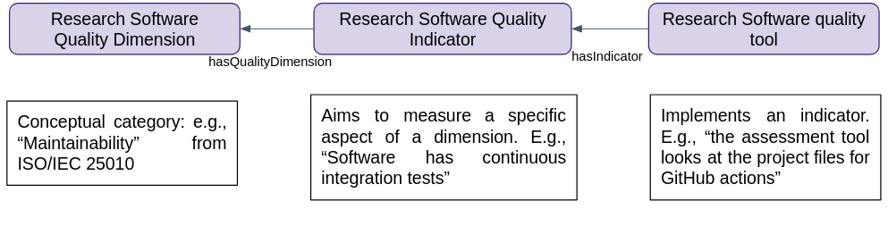

# 2 Quality Dimensions and Indicators for Research Software

EVERSE structures the discussion of research software quality around three concepts: quality dimensions, quality indicators and quality tools. This section defines them and then goes through each dimension.

**Quality dimensions** are broad categories of quality, defined at a conceptual level (e.g., maintainability, security, FAIRness). They give a shared vocabulary and a way to sort everything else: practices, indicators and tools are all attached to one or more dimensions. Dimensions are not measured directly.

**Quality indicators** are specific, checkable properties of a piece of software or of its development process (e.g., "software has a license", "software has continuous integration tests", "test coverage follows community conventions"). An indicator belongs to one or more dimensions and has a defined way of being assessed, which can be a yes/no check, a score or a threshold. The EVERSE indicators repository holds the canonical list: [https://everse.software/indicators/](https://everse.software/indicators/). In this document, indicators are referred to by their identifier, e.g. `software_has_license`.

**Quality tools** are the software, services or guides that act on indicators. We distinguish two roles:

- **Tools that measure an indicator** inspect the software, its repository or its metadata and report a value for the indicator, without changing anything. Examples: howfairis checks whether a repository has a license and a citation file; Pylint reports linting issues; Gitleaks scans the history for leaked credentials.
- **Tools that improve an indicator** help developers change the software or its process so that the indicator value gets better. Examples: cffinit generates a `CITATION.cff` file; GitHub Actions runs the tests on every change; pixi records and locks dependencies.

Some tools do both. Ruff reports linting issues and fixes many of them; Dependabot detects vulnerable dependencies and opens pull requests to update them. The distinction still matters: a measuring tool can provide an assessment, while an improving tool can help you implement. Running a measuring tool on a regular basis is itself a practice that some indicators capture, such as `uses_tool_for_warnings_and_mistakes`. The EVERSE Tech Radar ([https://everse.software/TechRadar/](https://everse.software/TechRadar/)) records, for each tool, which indicators it measures and which it improves.

Figure 1 shows how the three concepts fit together. The "Maintainability" dimension, as defined in ISO/IEC 25010, may be associated with an indicator that checks whether continuous integration tests exist in a source code repository (e.g., as defined by the OpenSSF community). An assessment tool like the OpenSSF Scorecard may measure this indicator by checking whether the project runs tests before pull requests are merged on GitHub. A different tool may measure the same indicator on GitLab repositories, which OpenSSF Scorecard does not support. A CI service such as GitLab CI/CD does not measure anything, but it is how a project improves that indicator.

{ width=90% }

The EVERSE Framework encompasses thirteen dimensions of research software quality, derived from established standards and research software best practices. Nine are technical dimensions taken from ISO/IEC 25010 (Section 2.1). The other four, FAIRness (Section 2.2), Open Source Software (Section 2.3), Sustainability (Section 2.4) and Community (Section 2.5), reflect requirements specific to research software. For each dimension, we describe what it covers, list "good enough" practices, and give examples of indicators together with tools that measure or improve them. These examples are illustrative, not exhaustive; the EVERSE indicators repository and the Tech Radar are the up-to-date references.
